# Energy Components

All energy components in the `ENERGY_NETWORK`, grouped as sources, providers and consumers. The connections on each
component are coloured by energy type: inputs show what a component accepts, outputs show what it provides.
Two components can be connected when the output colour of one matches the input colour of the next.
See the [Energy Reference](./energy-reference.mdx) for the full description of every element.

```mermaid
graph TB
    subgraph legend ["Energy types"]
        direction LR
        legend_FUEL_GAS(["FUEL_GAS"])
        legend_ELECTRICAL(["ELECTRICAL"])
        legend_MECHANICAL(["MECHANICAL"])
        legend_DIESEL(["DIESEL"])
    end
    subgraph category_Sources ["Sources"]
        subgraph box_FUEL_GAS_SOURCE [" "]
            direction LR
            FUEL_GAS_SOURCE["FUEL_GAS_SOURCE"]
            FUEL_GAS_SOURCE --> FUEL_GAS_SOURCE_out_FUEL_GAS(["FUEL_GAS"])
        end
        subgraph box_ELECTRICAL_SOURCE [" "]
            direction LR
            ELECTRICAL_SOURCE["ELECTRICAL_SOURCE"]
            ELECTRICAL_SOURCE --> ELECTRICAL_SOURCE_out_ELECTRICAL(["ELECTRICAL"])
        end
        subgraph box_DIESEL_SOURCE [" "]
            direction LR
            DIESEL_SOURCE["DIESEL_SOURCE"]
            DIESEL_SOURCE --> DIESEL_SOURCE_out_DIESEL(["DIESEL"])
        end
    end
    subgraph category_Providers ["Providers"]
        subgraph box_GENERATOR [" "]
            direction LR
            GENERATOR["GENERATOR"]
            GENERATOR_in_FUEL_GAS(["FUEL_GAS"]) --> GENERATOR
            GENERATOR_in_DIESEL(["DIESEL"]) --> GENERATOR
            GENERATOR --> GENERATOR_out_ELECTRICAL(["ELECTRICAL"])
        end
        subgraph box_GAS_TURBINE [" "]
            direction LR
            GAS_TURBINE["GAS_TURBINE"]
            GAS_TURBINE_in_FUEL_GAS(["FUEL_GAS"]) --> GAS_TURBINE
            GAS_TURBINE --> GAS_TURBINE_out_MECHANICAL(["MECHANICAL"])
        end
        subgraph box_ELECTRICAL_MOTOR [" "]
            direction LR
            ELECTRICAL_MOTOR["ELECTRICAL_MOTOR"]
            ELECTRICAL_MOTOR_in_ELECTRICAL(["ELECTRICAL"]) --> ELECTRICAL_MOTOR
            ELECTRICAL_MOTOR --> ELECTRICAL_MOTOR_out_MECHANICAL(["MECHANICAL"])
        end
        subgraph box_ELECTRICAL_CABLE [" "]
            direction LR
            ELECTRICAL_CABLE["ELECTRICAL_CABLE"]
            ELECTRICAL_CABLE_in_ELECTRICAL(["ELECTRICAL"]) --> ELECTRICAL_CABLE
            ELECTRICAL_CABLE --> ELECTRICAL_CABLE_out_ELECTRICAL(["ELECTRICAL"])
        end
        subgraph box_ELECTRICAL_BUS [" "]
            direction LR
            ELECTRICAL_BUS["ELECTRICAL_BUS"]
            ELECTRICAL_BUS_in_ELECTRICAL(["ELECTRICAL"]) --> ELECTRICAL_BUS
            ELECTRICAL_BUS --> ELECTRICAL_BUS_out_ELECTRICAL(["ELECTRICAL"])
        end
        subgraph box_FUEL_GAS_MANIFOLD [" "]
            direction LR
            FUEL_GAS_MANIFOLD["FUEL_GAS_MANIFOLD"]
            FUEL_GAS_MANIFOLD_in_FUEL_GAS(["FUEL_GAS"]) --> FUEL_GAS_MANIFOLD
            FUEL_GAS_MANIFOLD --> FUEL_GAS_MANIFOLD_out_FUEL_GAS(["FUEL_GAS"])
        end
    end
    subgraph category_Consumers ["Consumers"]
        subgraph box_ELECTRICAL_CONSUMER [" "]
            direction LR
            ELECTRICAL_CONSUMER["ELECTRICAL_CONSUMER"]
            ELECTRICAL_CONSUMER_in_ELECTRICAL(["ELECTRICAL"]) --> ELECTRICAL_CONSUMER
        end
        subgraph box_MECHANICAL_CONSUMER [" "]
            direction LR
            MECHANICAL_CONSUMER["MECHANICAL_CONSUMER"]
            MECHANICAL_CONSUMER_in_MECHANICAL(["MECHANICAL"]) --> MECHANICAL_CONSUMER
        end
        subgraph box_DRIVE_TRAIN [" "]
            direction LR
            DRIVE_TRAIN["DRIVE_TRAIN"]
            DRIVE_TRAIN_in_MECHANICAL(["MECHANICAL"]) --> DRIVE_TRAIN
        end
        subgraph box_FUEL_GAS_CONSUMER [" "]
            direction LR
            FUEL_GAS_CONSUMER["FUEL_GAS_CONSUMER"]
            FUEL_GAS_CONSUMER_in_FUEL_GAS(["FUEL_GAS"]) --> FUEL_GAS_CONSUMER
        end
        subgraph box_DIESEL_CONSUMER [" "]
            direction LR
            DIESEL_CONSUMER["DIESEL_CONSUMER"]
            DIESEL_CONSUMER_in_DIESEL(["DIESEL"]) --> DIESEL_CONSUMER
        end
        subgraph box_COMPRESSOR_SAMPLED [" "]
            direction LR
            COMPRESSOR_SAMPLED["COMPRESSOR_SAMPLED"]
            COMPRESSOR_SAMPLED_in_FUEL_GAS(["FUEL_GAS"]) --> COMPRESSOR_SAMPLED
            COMPRESSOR_SAMPLED_in_ELECTRICAL(["ELECTRICAL"]) --> COMPRESSOR_SAMPLED
            COMPRESSOR_SAMPLED_in_MECHANICAL(["MECHANICAL"]) --> COMPRESSOR_SAMPLED
        end
    end
    classDef FUEL_GAS fill:#f0a35e,stroke:#f0a35e,color:#000
    class legend_FUEL_GAS,FUEL_GAS_SOURCE_out_FUEL_GAS,GENERATOR_in_FUEL_GAS,GAS_TURBINE_in_FUEL_GAS,FUEL_GAS_MANIFOLD_in_FUEL_GAS,FUEL_GAS_MANIFOLD_out_FUEL_GAS,FUEL_GAS_CONSUMER_in_FUEL_GAS,COMPRESSOR_SAMPLED_in_FUEL_GAS FUEL_GAS
    linkStyle 0,3,6,14,15,19,21 stroke:#f0a35e,stroke-width:3px
    classDef ELECTRICAL fill:#5b9bd5,stroke:#5b9bd5,color:#000
    class legend_ELECTRICAL,ELECTRICAL_SOURCE_out_ELECTRICAL,GENERATOR_out_ELECTRICAL,ELECTRICAL_MOTOR_in_ELECTRICAL,ELECTRICAL_CABLE_in_ELECTRICAL,ELECTRICAL_CABLE_out_ELECTRICAL,ELECTRICAL_BUS_in_ELECTRICAL,ELECTRICAL_BUS_out_ELECTRICAL,ELECTRICAL_CONSUMER_in_ELECTRICAL,COMPRESSOR_SAMPLED_in_ELECTRICAL ELECTRICAL
    linkStyle 1,5,8,10,11,12,13,16,22 stroke:#5b9bd5,stroke-width:3px
    classDef MECHANICAL fill:#70ad47,stroke:#70ad47,color:#000
    class legend_MECHANICAL,GAS_TURBINE_out_MECHANICAL,ELECTRICAL_MOTOR_out_MECHANICAL,MECHANICAL_CONSUMER_in_MECHANICAL,DRIVE_TRAIN_in_MECHANICAL,COMPRESSOR_SAMPLED_in_MECHANICAL MECHANICAL
    linkStyle 7,9,17,18,23 stroke:#70ad47,stroke-width:3px
    classDef DIESEL fill:#a6a6a6,stroke:#a6a6a6,color:#000
    class legend_DIESEL,DIESEL_SOURCE_out_DIESEL,GENERATOR_in_DIESEL,DIESEL_CONSUMER_in_DIESEL DIESEL
    linkStyle 2,4,20 stroke:#a6a6a6,stroke-width:3px
```

- `GENERATOR` accepts fuel gas or diesel and provides electrical power.
- `ELECTRICAL_BUS` and `FUEL_GAS_MANIFOLD` provide the same energy type as their inputs.
- `COMPRESSOR_SAMPLED` accepts fuel gas, electrical or mechanical energy, depending on the energy columns in its `FILE`.
- `DRIVE_TRAIN` accepts mechanical energy and refers to a shaft.
