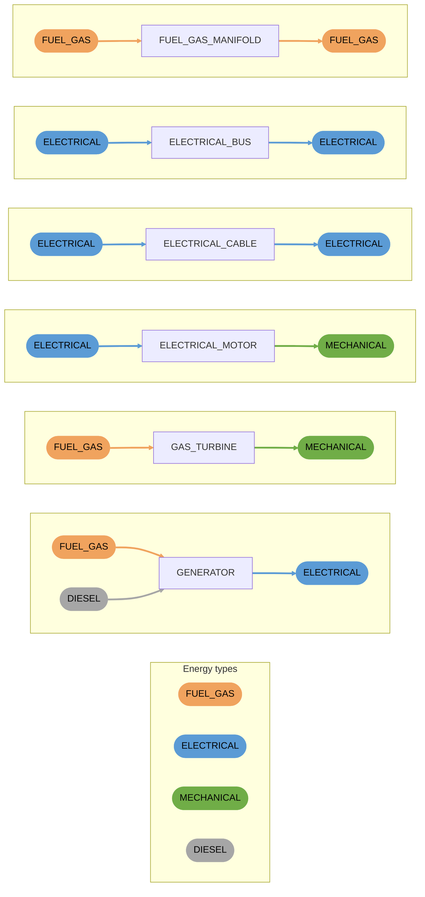

# Providers

Components that take energy in and provide energy to other components, such as converters and junctions. Connections are coloured by the energy type they accept or provide.

- `GENERATOR` accepts fuel gas or diesel and provides electrical power.
- `ELECTRICAL_BUS` and `FUEL_GAS_MANIFOLD` provide the same energy type as their inputs.
