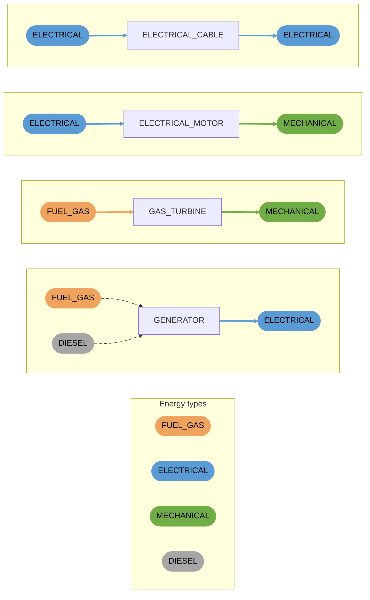
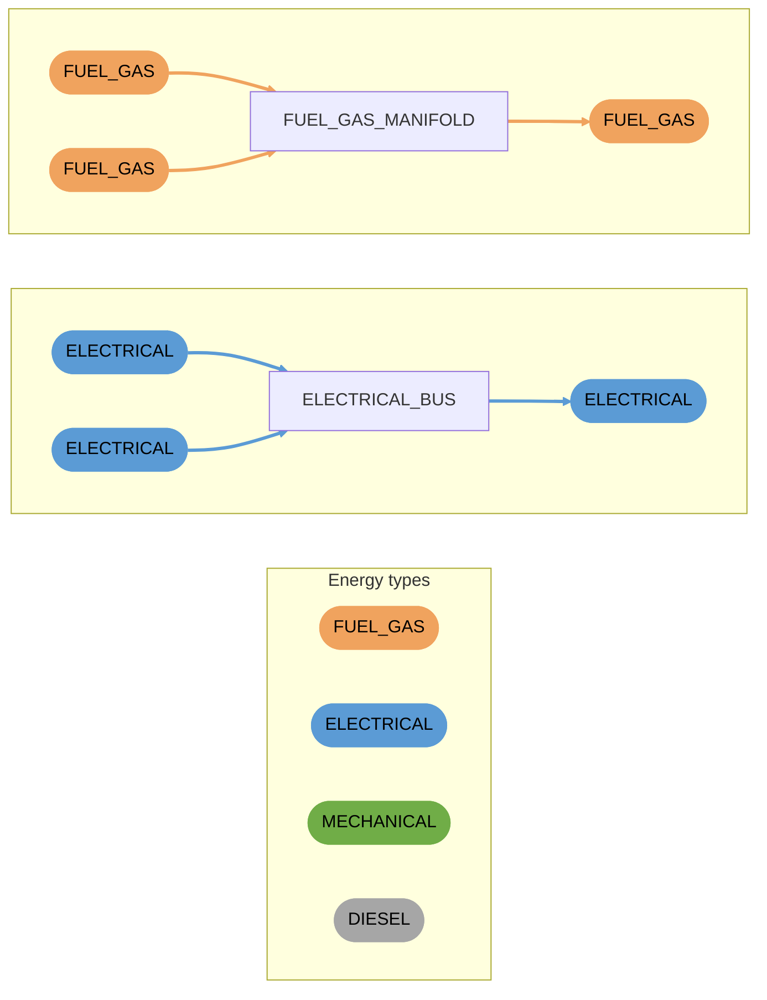

# Providers

Components that take energy in and provide energy to other components, such as converters and junctions. Connections are coloured by the energy type they accept or provide.

## Converters

Convert one energy type into another, or pass it on with losses. Each converter has one input.

- `GENERATOR` accepts fuel gas or diesel and provides electrical power.

## Junctions

Collect several suppliers of the same energy type and dispatch demand between them. A junction provides the same energy type as its inputs.

