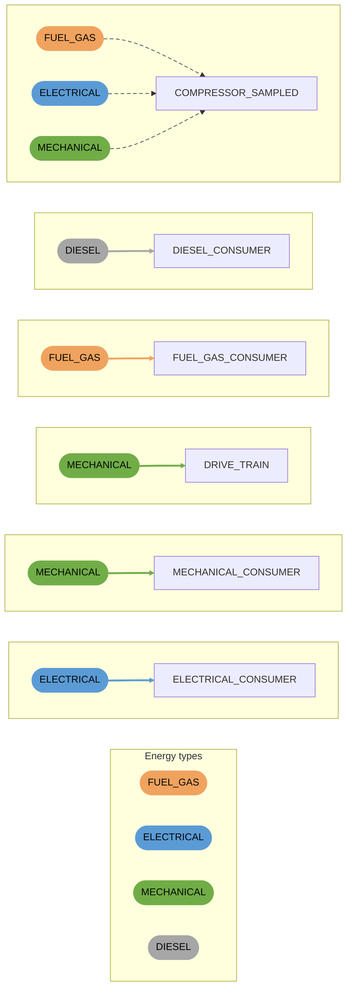

# Consumers

Use energy from the network. Consumers only have an input. Connections are coloured by the energy type they accept or provide.

- `COMPRESSOR_SAMPLED` accepts fuel gas, electrical or mechanical energy, depending on the energy columns in its `FILE`.
- `DRIVE_TRAIN` accepts mechanical energy and refers to a shaft.
