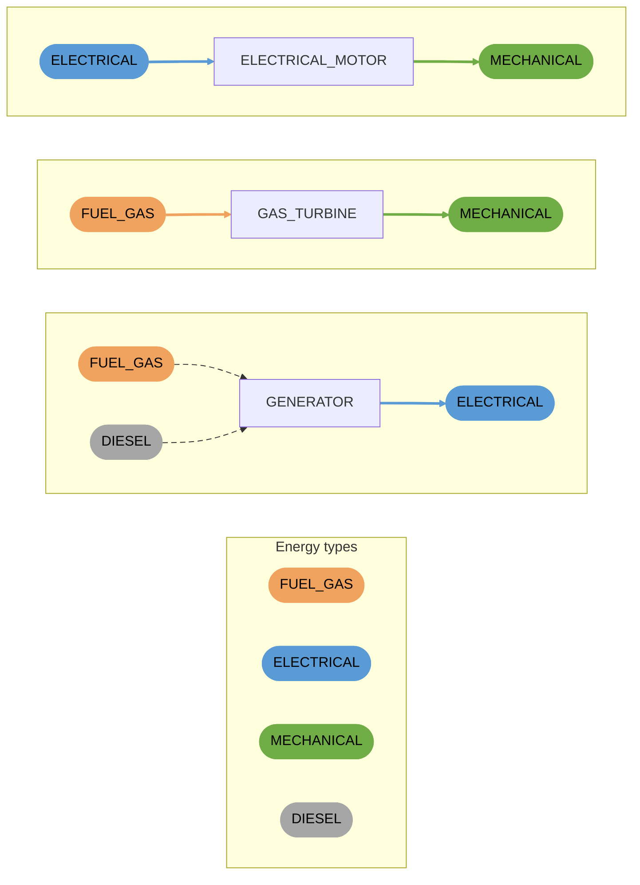

# Converters

Convert one energy type into another. Each converter has one input. Connections are coloured by the energy type they accept or provide.

- `GENERATOR` accepts fuel gas or diesel and provides electrical power.
