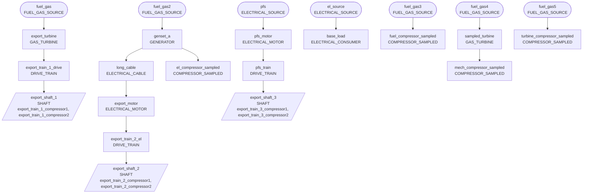

{/* Generated by src/generate_fixture.py. Do not edit. */}

import CodeBlock from '@theme/CodeBlock';
import yamlModel from '!!raw-loader!@examples/nextgen/v4/model.yaml';
import resource0 from '!!raw-loader!@examples/nextgen/v4/base_profile.csv';
import resource1 from '!!raw-loader!@examples/nextgen/v4/compressor_chart.csv';
import resource2 from '!!raw-loader!@examples/nextgen/v4/sampled_el_compressor.csv';
import resource3 from '!!raw-loader!@examples/nextgen/v4/sampled_fuel_compressor.csv';
import resource4 from '!!raw-loader!@examples/nextgen/v4/sampled_fuel_turbine.csv';
import resource5 from '!!raw-loader!@examples/nextgen/v4/sampled_mech_compressor.csv';

# NextGen model example, In production (v4)

## Energy network {/* #energy-network */}

This is an example of a NextGen eCalc model using `YAML_VERSION: 4`, which is in production.
It is generated from the model builders in the eCalc library, and verified by the library tests.
See the [Process Reference](../process-reference.mdx) and the [Energy Reference](../energy-reference.mdx) for a
description of every element, and the [YAML Changelog](../yaml-changelog/index.md) for what changed between versions.

The model contains:

- Four export trains with two compressors each, defined in `COMPRESSORS`, placed on a `SHAFTS` entry per train, and run in
  `PROCESS_PIPELINES` with a compressor model from `DEFINITIONS.COMPRESSOR_MODELS`.
- A `TIMELINE` event that rebundles the compressors of the first export train.
- One `PROCESS_SIMULATIONS` entry that distributes a common inlet stream between the export trains, with constraints for each
  train.
- An `ENERGY_NETWORK` with fuel gas and electrical sources, generator, gas turbines, electrical cable and motors, drive
  trains for the export trains, an electrical consumer, and sampled compressors that are driven electrically,
  mechanically and by fuel.

## Full eCalc YAML model {/* #full-ecalc-yaml-model */}

<CodeBlock title="model.yaml" language="yaml">{yamlModel}</CodeBlock>

### Input files {/* #input-files */}

<CodeBlock title="base_profile.csv">{resource0}</CodeBlock>
<CodeBlock title="compressor_chart.csv">{resource1}</CodeBlock>
<CodeBlock title="sampled_el_compressor.csv">{resource2}</CodeBlock>
<CodeBlock title="sampled_fuel_compressor.csv">{resource3}</CodeBlock>
<CodeBlock title="sampled_fuel_turbine.csv">{resource4}</CodeBlock>
<CodeBlock title="sampled_mech_compressor.csv">{resource5}</CodeBlock>
