{/* Generated by src/generate_fixture.py. Do not edit. */}

import CodeBlock from '@theme/CodeBlock';
import yamlModel from '!!raw-loader!@examples/nextgen/v5/model.yaml';
import resource0 from '!!raw-loader!@examples/nextgen/v5/base_profile.csv';
import resource1 from '!!raw-loader!@examples/nextgen/v5/compressor_chart.csv';
import resource2 from '!!raw-loader!@examples/nextgen/v5/sampled_el_compressor.csv';
import resource3 from '!!raw-loader!@examples/nextgen/v5/sampled_mech_compressor.csv';

# NextGen model example, In development (v5)

## Energy network {/* #energy-network */}

```mermaid
graph TD
    fuel_gas(["fuel_gas<br/>FUEL_GAS_SOURCE"])
    fuel_gas2(["fuel_gas2<br/>FUEL_GAS_SOURCE"])
    fuel_gas3(["fuel_gas3<br/>FUEL_GAS_SOURCE"])
    el_source(["el_source<br/>ELECTRICAL_SOURCE"])
    pfs(["pfs<br/>ELECTRICAL_SOURCE"])
    export_turbine["export_turbine<br/>GAS_TURBINE"]
    genset_a["genset_a<br/>GENERATOR"]
    long_cable["long_cable<br/>ELECTRICAL_CABLE"]
    export_motor["export_motor<br/>ELECTRICAL_MOTOR"]
    drive_train_export_shaft_1["DRIVE_TRAIN"]
    drive_train_export_shaft_2["DRIVE_TRAIN"]
    pfs_motor["pfs_motor<br/>ELECTRICAL_MOTOR"]
    drive_train_export_shaft_3["DRIVE_TRAIN"]
    base_load["base_load<br/>ELECTRICAL_CONSUMER"]
    sampled_el_motor["sampled_el_motor<br/>ELECTRICAL_MOTOR"]
    sampled_el_compressor["sampled_el_compressor<br/>COMPRESSOR_SAMPLED"]
    sampled_turbine["sampled_turbine<br/>GAS_TURBINE"]
    sampled_mech_compressor["sampled_mech_compressor<br/>COMPRESSOR_SAMPLED"]
    shaft_export_shaft_1[/"export_shaft_1<br/>SHAFT"/]
    shaft_export_shaft_2[/"export_shaft_2<br/>SHAFT"/]
    shaft_export_shaft_3[/"export_shaft_3<br/>SHAFT"/]
    compressor_export_train_1_compressor1[["export_train_1_compressor1<br/>COMPRESSOR"]]
    compressor_export_train_1_compressor2[["export_train_1_compressor2<br/>COMPRESSOR"]]
    compressor_export_train_2_compressor1[["export_train_2_compressor1<br/>COMPRESSOR"]]
    compressor_export_train_2_compressor2[["export_train_2_compressor2<br/>COMPRESSOR"]]
    compressor_export_train_3_compressor1[["export_train_3_compressor1<br/>COMPRESSOR"]]
    compressor_export_train_3_compressor2[["export_train_3_compressor2<br/>COMPRESSOR"]]
    compressor_export_train_4_compressor1[["export_train_4_compressor1<br/>COMPRESSOR"]]
    compressor_export_train_4_compressor2[["export_train_4_compressor2<br/>COMPRESSOR"]]
    pipeline_export_train_1[["export_train_1<br/>PROCESS_PIPELINE"]]
    pipeline_export_train_2[["export_train_2<br/>PROCESS_PIPELINE"]]
    pipeline_export_train_3[["export_train_3<br/>PROCESS_PIPELINE"]]
    pipeline_export_train_4[["export_train_4<br/>PROCESS_PIPELINE"]]
    fuel_gas --> export_turbine
    fuel_gas2 --> genset_a
    genset_a --> long_cable
    long_cable --> export_motor
    export_turbine --> drive_train_export_shaft_1
    export_motor --> drive_train_export_shaft_2
    pfs --> pfs_motor
    pfs_motor --> drive_train_export_shaft_3
    el_source --> base_load
    genset_a --> sampled_el_motor
    sampled_el_motor --> sampled_el_compressor
    fuel_gas3 --> sampled_turbine
    sampled_turbine --> sampled_mech_compressor
    drive_train_export_shaft_1 --> shaft_export_shaft_1
    drive_train_export_shaft_2 --> shaft_export_shaft_2
    drive_train_export_shaft_3 --> shaft_export_shaft_3
    shaft_export_shaft_1 --> compressor_export_train_1_compressor1
    shaft_export_shaft_1 --> compressor_export_train_1_compressor2
    shaft_export_shaft_2 --> compressor_export_train_2_compressor1
    shaft_export_shaft_2 --> compressor_export_train_2_compressor2
    shaft_export_shaft_3 --> compressor_export_train_3_compressor1
    shaft_export_shaft_3 --> compressor_export_train_3_compressor2
    compressor_export_train_1_compressor1 --> pipeline_export_train_1
    compressor_export_train_1_compressor2 --> pipeline_export_train_1
    compressor_export_train_2_compressor1 --> pipeline_export_train_2
    compressor_export_train_2_compressor2 --> pipeline_export_train_2
    compressor_export_train_3_compressor1 --> pipeline_export_train_3
    compressor_export_train_3_compressor2 --> pipeline_export_train_3
    compressor_export_train_4_compressor1 --> pipeline_export_train_4
    compressor_export_train_4_compressor2 --> pipeline_export_train_4
    classDef process fill:#fde8c8,stroke:#d98a00,color:#000
    class compressor_export_train_1_compressor1,compressor_export_train_1_compressor2,compressor_export_train_2_compressor1,compressor_export_train_2_compressor2,compressor_export_train_3_compressor1,compressor_export_train_3_compressor2,compressor_export_train_4_compressor1,compressor_export_train_4_compressor2,pipeline_export_train_1,pipeline_export_train_2,pipeline_export_train_3,pipeline_export_train_4 process
```

The energy network is shown at the top, and the energy demand from the process model (compressors and process
pipelines) is shown in orange at the bottom.

This is an example of a NextGen eCalc model using `YAML_VERSION: 5`, which is in development.
It is generated from the model builders in the eCalc library, and verified by the library tests.
See the [Process Reference](../process-reference.mdx) and the [Energy Reference](../energy-reference.mdx) for a
description of every element, and the [YAML Changelog](../yaml-changelog/index.md) for what changed between versions.

The model contains:

- Four export trains with two compressors each, defined in `COMPRESSORS`, placed on a `SHAFTS` entry per train, and run in
  `PROCESS_PIPELINES` with a compressor model from `DEFINITIONS.COMPRESSOR_MODELS`.
- A `TIMELINE` event that rebundles the compressors of the first export train.
- One `PROCESS_SIMULATIONS` entry that distributes a common inlet stream between the export trains, with constraints for each
  train.
- An `ENERGY_NETWORK` with fuel gas and electrical sources, generator, gas turbines, electrical cable and motors, drive
  trains for the export trains, an electrical consumer, and sampled compressors driven by an electrical motor and by
  a gas turbine.
- `MECHANICAL_EFFICIENCIES` on `export_train_1_drive`, for both compressors on its shaft, and on `export_train_2_el`,
  for one compressor. The other compressor has efficiency 1.0.

## Download {/* #download */}

[Download example_model_v5.zip](/examples/nextgen/example_model_v5.zip) with the YAML
model, the input files and `export_info.json`.

## Full eCalc YAML model {/* #full-ecalc-yaml-model */}

<CodeBlock title="model.yaml" language="yaml">{yamlModel}</CodeBlock>

### Input files {/* #input-files */}

<CodeBlock title="base_profile.csv">{resource0}</CodeBlock>
<CodeBlock title="compressor_chart.csv">{resource1}</CodeBlock>
<CodeBlock title="sampled_el_compressor.csv">{resource2}</CodeBlock>
<CodeBlock title="sampled_mech_compressor.csv">{resource3}</CodeBlock>
